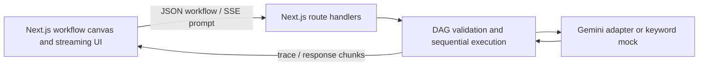

# Synapse AI

[](https://github.com/Erentass6/synapse-ai/actions/workflows/ci.yml)
[](https://nextjs.org/)
[](https://www.typescriptlang.org/)
[](LICENSE)

An interactive portfolio prototype for designing multi-step AI workflows and inspecting their execution traces. Synapse combines a workflow canvas, a small TypeScript orchestration engine, and a streaming interface in one Next.js application.

> **Project status:** early-stage prototype. There is no hosted demo yet. The mock provider is useful for trying the interface without an API key; it is not a substitute for a production language model.

## What it demonstrates

- **Workflow execution:** validates node references and cycles, computes a topological order, resolves `{{input.*}}` and `{{nodes.*}}` templates, and records per-step results.
- **Workflow canvas:** explore and run example workflows made from trigger, prompt, LLM, tool, condition, and output nodes.
- **Streaming UI:** an SSE endpoint sends generated response text in chunks and the interface reports time-to-first-chunk and throughput estimates.
- **Provider adapter:** uses Google Gemini when `GEMINI_API_KEY` is configured; otherwise it uses a keyword-based mock response.
- **Built-in tools:** try basic text summarization, JSON parsing, sentiment heuristics, and arithmetic expressions in workflow steps.
- **Execution safeguards:** the workflow endpoint validates its request shape, applies an in-memory token-bucket limiter, and checks prompts against simple patterns.

## Architecture



## Run locally

### Requirements

- Node.js 20 or newer
- npm

### Install and start

```bash
git clone https://github.com/Erentass6/synapse-ai.git
cd synapse-ai
npm ci
copy .env.example .env.local  # PowerShell
npm run dev
```

On macOS/Linux, use `cp .env.example .env.local` instead. Open [http://localhost:3000](http://localhost:3000).

The app works without credentials using the mock provider. To enable live Gemini requests, add a Google Gemini API key to `.env.local`:

```dotenv
GEMINI_API_KEY=your_key_here
```

Keep `.env.local` private; it is excluded from Git. The checked-in `.env.example` contains no credentials.

## Tests and CI

Run the Vitest suite locally:

```bash
npm test
```

GitHub Actions runs TypeScript type checking, the Vitest suite, and a production build for pushes and pull requests targeting `main`, `master`, or `develop`.

## Docker

With Docker Desktop installed, build and start the production container with:

```bash
docker compose up --build
```

The app is available at [http://localhost:3000](http://localhost:3000). Set `GEMINI_API_KEY` in your shell or an untracked `.env` file if you want to use the live Gemini adapter.

## API routes

### `POST /api/workflows/run`

Accepts a workflow definition and optional input, then returns a trace. The request is schema-validated before execution.

```json
{
  "workflow": {
    "id": "example",
    "name": "Example workflow",
    "nodes": [
      { "id": "start", "type": "trigger", "title": "Start", "config": {} }
    ],
    "edges": []
  },
  "input": { "prompt": "Hello" }
}
```

### `POST /api/stream`

Accepts `{ "prompt": "...", "model": "mock-fast", "language": "en" }` and returns an SSE response. The current implementation produces the response first and then emits text chunks; it does not stream tokens directly from Gemini.

## Current scope and limitations

This repo is intentionally explicit about what is implemented:

- Workflow nodes execute in topological order, one at a time; independent branches are not run in parallel.
- Gemini is the only live provider wired to an API. Other model choices currently use the mock response path.
- The mock uses keyword-based templates and an artificial delay; it does not perform AI inference.
- Token counts and costs are estimates based on a character heuristic and a static price table.
- The rate limiter is in-memory and process-local; it is not a distributed limiter.
- Prompt checks are simple pattern checks, not a security boundary. Do not expose this prototype as a public production service without a proper security review.
- Telemetry is application-level trace data; OpenTelemetry export is not implemented.

## Technology

Next.js 15 · React 19 · TypeScript · Tailwind CSS · Zod · Vitest · GitHub Actions

## License

MIT. See [LICENSE](LICENSE).
